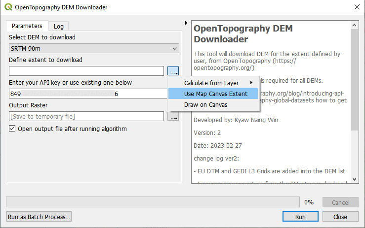
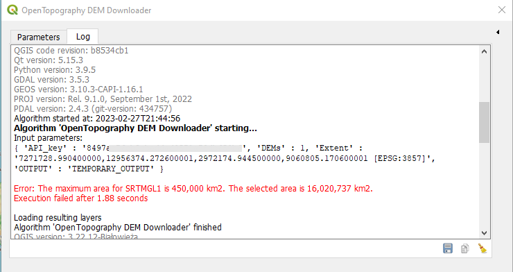
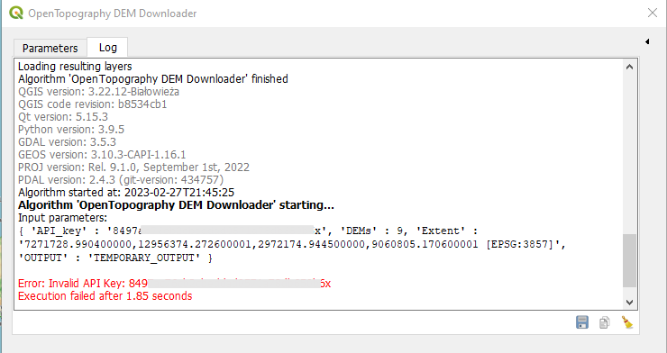
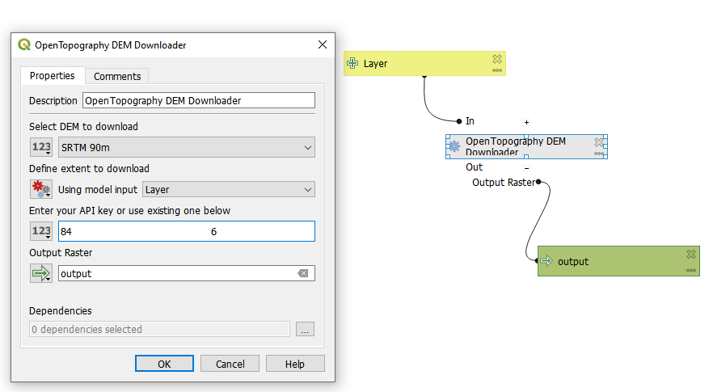

# OpenTopography-DEM-Downloader-qgis-plugin
ver-4.1

QGIS versions 3.x or 4.x 

A QGIS plugin to download DEMs from OpenTopography.org

This plug-in allows you to download DEMs from OpenTopgraphy.org by specifying area extent in QGIS. The downloaded DEM wil just cover the defined extent.
  1 . a Layer in the content
  2 . current canvas extent
  3 . user specified extent drawn on the canvas
  

  
<<<<<<< Updated upstream
DEMs availables to donwload:
  1. SRTM 90m [read details](https://doi.org/10.5069/G9445JDF)
  2. SRTM 30m [read details](https://doi.org/10.5069/G9445JDF)
  3. SRTM GL1 Ellipsoidal 30m [read details](https://doi.org/10.5069/G9445JDF)
  4. ALOS World 3D 30m [read details](https://doi.org/10.5069/G94M92HB)
  5. Global Bathymetry SRTM15+ V2.1 [read details](https://doi.org/10.5069/G92R3PT9)
  7. Copernicus Global DSM 30m [read details](https://doi.org/10.5069/G9028PQB)
  8. Copernicus Global DSM 90m [read details](https://doi.org/10.5069/G9028PQB)
  9. NASADEM Global DEM [read details](https://doi.org/10.5069/G93T9FD9)
  10. EU DTM [read details](https://doi.org/10.5069/G99021ZF)
  11. GEDI L3 1km [read details](https://doi.org/10.5069/G9V12301)
  12. GEBCOIceTopo Bathymetry 500m [read details](https://doi.org/10.5069/G9D21VTT)
  13. GEBCOSubIceTopo Bathymetry 500m [read details](https://doi.org/10.5069/G9D21VTT)

** You will need a free OpenTopography personal API Key to download these DEMs as per requirement of OpenTopography. To obtain an OpenTopography API key:
1. Create an [OpenTopography account](https://portal.opentopography.org/newUser) or [log into your existing OpenTopography account] (https://portal.opentopography.org/login)
2. Click the [Request an API Key](https://portal.opentopography.org/requestService?service=api) link on the OpenTopography.org homepage.
=======
DEMs availables to download:
  1. SRTM 90m [read details](https://portal.opentopography.org/raster?opentopoID=OTSRTM.042013.4326.1)
  2. SRTM 30m [read details](https://portal.opentopography.org/raster?opentopoID=OTSRTM.082015.4326.1)
  3. ALOS World 3D 30m [read details](https://portal.opentopography.org/raster?opentopoID=OTALOS.112016.4326.2)
  4. SRTM GL1 Ellipsoidal 30m [read details](https://portal.opentopography.org/raster?opentopoID=OTSRTM.082016.4326.1)
  5. Global Bathymetry SRTM15+ V2.1 [read details](https://portal.opentopography.org/raster?opentopoID=OTSRTM.122019.4326.1)
  6. Copernicus Global DSM 30m [read details](https://portal.opentopography.org/raster?opentopoID=OTSDEM.032021.4326.3)
  7. Copernicus Global DSM 90m [read details](https://portal.opentopography.org/raster?opentopoID=OTSDEM.032021.4326.1)
  8. NASADEM Global DEM [read details](https://portal.opentopography.org/raster?opentopoID=OTSDEM.032021.4326.2)
  9. EU DTM [read details](https://portal.opentopography.org/datasetMetadata?otCollectionID=OT.092022.3035.1)
  10. GEDI L3 1km [read details](https://portal.opentopography.org/datasetMetadata?otCollectionID=OT.032022.4326.1)
  11. GEBCOIceTopo Bathymetry 500m [read details](https://portal.opentopography.org/raster?opentopoID=OTSDEM.122023.4326.1)
  12. GEBCOSubIceTopo Bathymetry 500m [read details](https://portal.opentopography.org/raster?opentopoID=OTSDEM.122023.4326.2)

** You will need an access key to download these DEMs as per requirement of the OpenTopography.org.
Read detail instruction to get an access key here.. https://opentopography.org/blog/introducing-api-keys-access-opentopography-global-datasets
>>>>>>> Stashed changes

## Extent limitations
There is a limit on extent in a request.

According the OpenTopgraphy.org the extent limits are as follow..
 - 125,000,000 km2 for SRTM15+ V2.1, 
 - 4,050,000 km2 for SRTM GL3, COP90 and 
 - 450,000 km2 for all other data

In this version, the tool will responds with more information about the error.

Exceed coverage limit error

Access key error

## Layer input as extent in Graphical Modeler
Previously, when used in Graphical Modeler, the tool cannot accept layer as extent input. [suricactus](https://github.com/suricactus) has contributed the working code for this issue.

## How to check whether your access key is working or not!
You can test if your access key is ok or not with the below html request. Add your access key at the place of "YOUR_KEY" and copy the whole link, paste into the address box of a browser and strike Enter key. It should download a small DEM. (ref: https://opentopography.org/blog/introducing-api-keys-access-opentopography-global-datasets)

https://portal.opentopography.org/API/globaldem?demtype=NASADEM&south=45&north=46&west=-122&east=-121&outputFormat=GTiff&API_Key=YOUR_KEY

If you dont get a dem download via the above link then your access key is incorrect/wrong (trimmed or extra space). 
